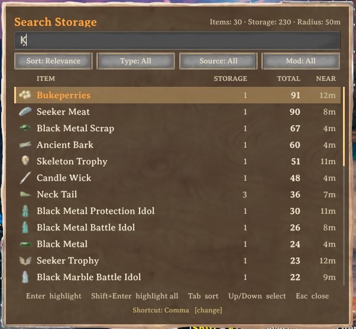
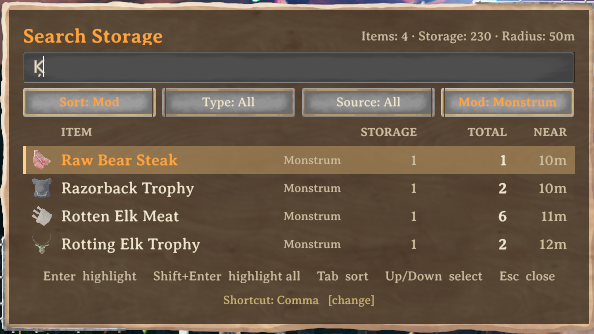
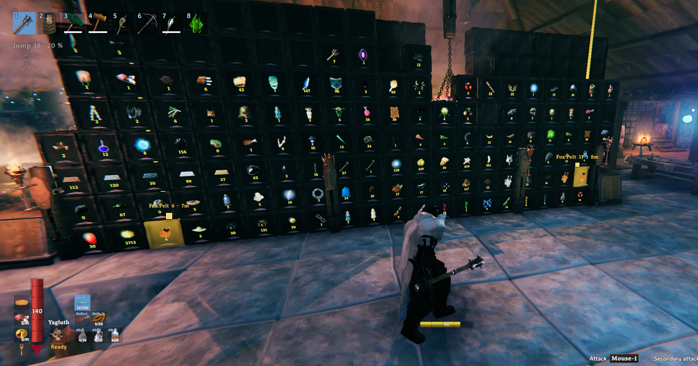
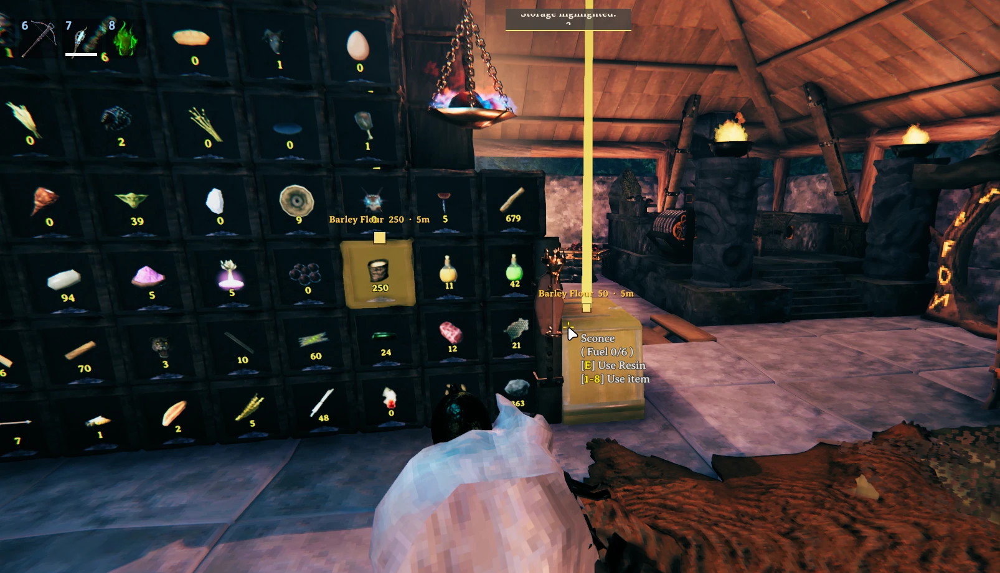

# HoardFinder

Press `Ctrl + F`, type part of an item name, and HoardFinder lists every stack of it stored around you: chests,
carts, ships, tombstones and BetrValheim drawers. Pick a result and every place that holds it lights up with a beam
and an on-screen marker you can see through walls.

It only runs on your client and never touches your items. Formerly published as BetrDrawerFinder.

## Screenshots

## Features

- Searches built chests (vanilla and modded), carts, ships and tombstones. Dungeon loot chests are optional.
- Searches [BetrValheim](https://thunderstore.io/c/valheim/p/DezzyCode/BetrValheim/) drawers when that mod is
  installed. Without it, everything else still works.
- Matches localized names and ignores case, spaces and accents, so `black metal`, `blackmetal` and `BLACK METAL`
  all find Black metal, and `pina` finds Piña.
- Each result shows the item icon, how many places hold it, the total amount and the distance to the nearest one.
- Sort by relevance, name, amount, distance, item type or source mod. Filter by item type, by kind of storage and
  by mod.
- Highlight one item, or every listed item at once with `Shift + Enter`. Each item gets its own color.
- The window is drawn with Valheim's own wood panel, text field and buttons, and uses the game's font.
- Follows the game's language setting. Translated into 36 languages, every one the game offers except Abenaki,
  which falls back to English.
- Only lists storage you could open yourself: wards and private chests are respected, like in vanilla.

## Controls

| Key | Action |
|---|---|
| `Ctrl + F` | Open or close the window |
| type | Search |
| `Up` / `Down`, `PageUp` / `PageDown`, mouse wheel | Move through the results |
| `Enter` or click | Highlight every place that holds the selected item |
| `Shift + Enter` or `Shift + click` | Highlight every item in the list |
| `Tab` / `Shift + Tab` | Change the sort order |
| `Esc` | Close |

While the window is open your character stands still and the camera does not move. Chat, the inventory and the
Escape menu stay closed until you close the window.

### Changing the shortcut

Click the **Shortcut: Ctrl + F [change]** line at the bottom of the window and press the new combination. It is
saved right away. `Esc` cancels, `Backspace` goes back to `Ctrl + F`. You can also edit `OpenSearchHotkey` in the
config file.

### Sorting and filtering

The four buttons under the search field cycle through their options: left click moves forward, right click moves
back. A button that is not on its default value is drawn highlighted.

| Button | Options |
|---|---|
| Sort | Relevance, Name, Amount, Distance, Type, Mod |
| Type | All, Materials, Food, Potions, Ammo, Equipment, Trophies, Other |
| Source | All, Drawers, Chests, Carts & ships, Tombstones, World loot |
| Mod | All, then each mod that has items nearby, vanilla first |

Relevance puts exact matches first, then names that start with what you typed, then names that contain it. Sort,
type and source are remembered between sessions. The Mod button needs Jotunn, which most modpacks already include;
items from mods also show the mod name in small text next to the item.

### Highlight

For 10 seconds (configurable) every matching place gets a pulsing glow, a light beam and a screen marker with the
item, the amount stored there and the distance. Markers stay visible through walls and stick to the screen edge
when the storage is behind you. In a big base only the 8 nearest markers show text, so the screen stays readable.

## Installation

Install with r2modman or the Thunderstore app. To install by hand, put `HoardFinder.dll` in
`BepInEx/plugins/HoardFinder/`.

**Updating from BetrDrawerFinder:** remove the old `BetrDrawerFinder` folder from `BepInEx/plugins`. Your settings
are copied over automatically the first time HoardFinder starts. If both are installed, HoardFinder does not load
and the BepInEx log says why.

## Requirements and compatibility

- BepInExPack for Valheim.
- Optional: BetrValheim (tested with 5.1.5) for drawer support.
- Optional: Jotunn for the mod sort and filter.

HoardFinder is client-side. The server does not need it, other players do not need it, and it does not take part
in Jotunn's version check. Valheim already sends chest contents to every nearby player, which is how the mod reads
them without opening anything. It never moves items, opens containers or writes world data.

## Configuration

The config file is `BepInEx/config/heido.valheim.hoardfinder.cfg`.

| Setting | Default | What it does |
|---|---|---|
| `SearchRadius` | 50 | Meters around you that are searched |
| `HighlightDuration` | 10 | Seconds a highlight lasts |
| `MaxSearchResults` | 50 | Rows in the result list |
| `OpenSearchHotkey` | `F + LeftControl` | Opens the window |
| `ClearHighlightHotkey` | empty | Removes a highlight early |
| `IncludeDrawers` | true | Search BetrValheim drawers |
| `IncludeChests` | true | Search built chests |
| `IncludeVehicles` | true | Search carts and ships |
| `IncludeTombstones` | true | Search tombstones |
| `IncludeWorldContainers` | false | Search dungeon and location loot |
| `RespectStorageAccess` | true | Hide storage you could not open |
| `DetectItemMods` | true | Detect which mod added each item (needs a restart) |
| `EnableDebugLogging` | false | Extra lines in the BepInEx log |

## Console commands

Open the console with `F5`:

- `hoard_search iron` prints the results for "iron".
- `hoard_dump` lists every stored stack within range.
- `hoard_clear` removes the current highlight.

## Known limits

- Only storage in loaded areas can be found. 50 m is well inside what the game keeps loaded around you.
- When another player moves items, the list catches up within a second or two, the normal sync delay.
- `Ctrl` is also crouch, so `Ctrl + F` makes you crouch for an instant. Change the shortcut if that bothers you.
- The glow depends on the storage's material. Beams and markers always work.
- The window has no gamepad support yet.
- Cyrillic, Greek, Asian, Thai and Hindi text uses Unity's default font instead of Valheim's, because the game font
  only covers Western European letters.

## Bugs and suggestions

Open an issue on the project page, and attach `BepInEx/LogOutput.log` if something went wrong.
